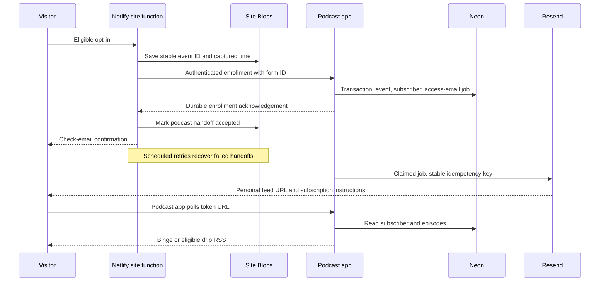

# Operational webhook implementation plan

Planning baseline: 17 September 2026. Proposed implementation, not completed work. Companion: [review](REVIEW-2026-09-17.md), [programming schedule](PROGRAMMING-SCHEDULE.md).

## Outcome and scope

A user submits an eligible form on either website, the correct show gets one active subscriber and a stable private feed token, and an access email supplies that feed URL. Binge exposes all published content immediately. Drip exposes only eligible published episodes relative to the subscriber's start time. Retries must not create extra subscribers, reset progress, undo revocation, or repeatedly email people.

Keep the current single-admin Next.js app. No SaaS accounts, CSV import, date-based scheduling, paid checkout, analytics dashboard rebuild, strict audio DRM, provider webhook marketplace or archive migration. Existing subscriber API remains available for trusted manual integration. Website code changes are necessary alongside the app; they must be separately reviewed in each repository.

## Proposed flow



Existing Bento marketing sync runs as a separately tracked site operation. A Bento outage must not block podcast handoff; podcast failure must not mark Bento sync failed. The user-facing request can attempt a bounded handoff, but success means the request was durably captured, not that email is already delivered. Never launch a fire-and-forget promise after returning from a serverless handler.

## Form and offer mapping

Add an explicit stable `form_id`/offer identifier to podcast forms; keep `source`, `channel`, `magnet`, and landing URL as attribution. `source=blog-...` alone is unsuitable as an entitlement rule. Each site's server validates the public form identifier against its own allowlist. The app independently maps `(authenticated integration identity, form_id)` to one approved show and email sender/template configuration. Browser-supplied `show_id`, feed type, sender, URL or start override must not be accepted.

| Website | Candidate surface from review | Proposed form ID | Show/mode/interval | Launch state |
| --- | --- | --- | --- | --- |
| donebythree.com | AudioSeriesOptin on home/blog/thanks | `dbt-audio-series` (placeholder) | AJ to supply actual show ID and BINGE or DRIP interval | Disabled until content and mapping verified |
| ajsilvers.com | Specific podcast opt-in still to identify | `TBD` | AJ to supply | Disabled |
| Either | Ordinary newsletter/resource opt-ins | Existing identifiers | No podcast by default | Preserve current non-podcast behavior |

AJ confirmed that form names are not configured yet; use placeholder identifiers in code fixtures and leave production mappings disabled. This is a configuration template, not approval to enroll all existing contacts or all forms. Do not replay historical generic opt-ins into podcasts. Only records bearing an explicit eligible podcast form/version and captured opt-in are eligible. Different offers can map to different shows; if the same content needs both modes at once, use separate shows for launch. The current model has show-wide scheduling.

## Authenticated enrollment contract

Add `POST /api/v1/enrollments`, authenticated with a separate server-side credential per website. Suggested secret names: `PODCAST_AJSILVERS_API_KEY`, `PODCAST_DONEBYTHREE_API_KEY` in the app; each website gets only its matching `PODCAST_API_KEY` and `PODCAST_API_BASE_URL`. Validate all required secrets at startup, parse strict Bearer syntax, compare safely and never log secrets. Bind the credential to allowed offers and the configured owner User; do not expose the broad admin API key to either browser or use it as a universal website credential.

Request shape:

```json
{
  "event_id": "stable-uuid-from-durable-site-record",
  "form_id": "dbt-audio-series",
  "email": "listener@example.com",
  "name": "Optional name",
  "captured_at": "2026-09-17T12:00:00.000Z"
}
```

Normalize email with trim/lowercase consistently across manual/API enrollment. Validate types before string operations; cap body and field sizes. Accept only reasonable non-future captured timestamps from the authenticated site; retain old timestamps on legitimate delayed retries. Do not silently rebase them to retry time. Allow old events only within a documented retention/recovery policy; quarantine records requiring operator review.

The service derives show and schedule, then transactionally persists:

- `EnrollmentEvent`: integration ID, unique external event ID, canonical payload hash, form/mapping version, subscriber relation, captured/received times and processing outcome. Unique `(integrationId, eventId)`.
- Existing `Subscriber`: unique `(showId, normalizedEmail)` and unique token. Use atomic upsert/unique-conflict recovery, not lookup-then-unprotected-create. Preserve token and start time on repeat enrollment.
- `DeliveryJob`: unique `(subscriberId, purpose, version)` for initial access, persisted recipient/template/sender/payload snapshot, stable provider idempotency key, attempts, next attempt time, lease, provider message ID and status. Job is created in the same transaction as successful enrollment.

Existing mixed-case duplicate rows require a read-only preflight report and reviewed reconciliation before normalization migration. Never automatically delete subscriber/feed history.

Responses: 201 for a newly committed event/enrollment, 200 for safe replay/existing enrollment, 400 for invalid input, 401 for missing/bad credentials, 404 for an unavailable offer, 409 for reused event ID with different payload or revoked enrollment, 413 for oversized body, 429 for throttling, 5xx for transient uncommitted failures. Return an enrollment reference and delivery state (`queued`, `accepted`, etc.) to the trusted caller. The site strips internal detail and returns only safe status to the browser. Do not return an existing subscriber's token based merely on entering their email address in a public form.

Enforce both event-level and subscriber-level deduplication: repeated submit may generate a new event ID, but must not create another initial-access email. A replay of the same event returns its recorded outcome. Never automatically reactivate a revoked subscriber, including via the existing v1 endpoint. Admin reactivation preserves schedule by default; resetting progress is an explicit separate action. An authenticated operator resend creates a new audited delivery version; there is no public lookup/resend endpoint in this release.

The existing `/api/v1/shows/[showId]/subscribers` should share the normalized, concurrency-safe subscriber service and correct errors. Keep its provision-only behavior documented; do not silently make every manual/API add send mail. The new enrollment endpoint owns the opt-in delivery workflow.

## Access email and retry behavior

Use a dedicated Resend API key for this app and an authenticated sender for each approved brand. One plain HTML plus text message includes show title, personal HTTPS RSS link, copy/paste instructions and supported-app instructions verified in staging. It is a requested access message, not a promotional sequence. No audio attachments or podcast directory submission. Disable tracking on bearer links where configurable; do not put tokens into site analytics or marketing profile fields.

Resend is proposed because the existing account can serve a discrete access message and supports provider idempotency. Bento remains responsible for existing marketing contact/automation work; do not create a second Bento feed email. This is a deliberate extension of the historical PRD's autoresponder design. [Resend idempotency](https://resend.com/docs/dashboard/emails/idempotency-keys) lasts 24 hours; it does not provide permanent exactly-once delivery.

Suggested processing policy:

- Attempt the queued job promptly with a bounded timeout after durable commit; a crash still leaves the job recoverable. A protected Vercel worker sweep every five minutes handles pending jobs; tune cadence to account capability and delivery target.
- Atomically claim jobs with leases and a unique stable key. Retry transient errors with backoff and jitter; honor provider rate-limit guidance. Keep payload identical for retries using the same key.
- Suggested delays: 1, 5, 15, 60 minutes, then bounded hourly retries. Actual execution occurs on the next worker sweep. Reclaim expired leases without concurrent sending.
- `accepted` means provider accepted/queued, not inbox delivery. Persist message ID; a signature-verified provider callback can mark delivered, bounced or failed. Deduplicate callback IDs, tolerate out-of-order events and ignore older state regressions.
- On ambiguous timeout, retry with the same key within a conservative window under 24 hours from first send attempt. Once that window is exhausted, quarantine for reconciliation; never blindly retry beyond provider deduplication expiry. Hard failures go to operator review. Do not claim mathematically exact-once email delivery.
- Expose pending/failed/unknown age and last redacted error in a small admin view or supported operator command; provide authenticated retry/resend tooling. Alert on oldest unresolved job >15 minutes and stale worker heartbeat. Do not depend only on the failing email provider to raise an alert; platform monitoring and an operator status view are required.

Vercel does not automatically retry a failed cron invocation; persist due work and process it on the next sweep. Protect worker access with `CRON_SECRET`, not dashboard-cookie middleware. Account for overlapping invocations ([cron docs](https://vercel.com/docs/cron-jobs/manage-cron-jobs)).

## Website work and recovery

Both websites need stable event IDs and captured times saved before external calls. Done by Three's existing record format must be extended without overwriting unrelated fields. AJ Silvers needs equivalent durable capture, timeouts and replay, plus the explicitly scoped Engage-to-Bento switch with regression tests for normal forms.

Track independent operation state: marketing contact sync, marketing event sync, podcast enrollment handoff. Do not reuse one `synced` flag. Keep legacy records readable and do not replay already-successful marketing events simply because a podcast handoff failed. A durable record should include retry time, attempts, last error code and final enrollment reference. Never store a feed token in public page HTML or broad analytics.

Use a bounded scheduled Netlify replay function per site for podcast handoffs, plus a dry-run/manual replay command. Paginate Blobs scans, filter eligible pending records, preserve original event IDs and timestamps, and stop on a time budget with remaining records pending. App idempotency makes repeated handoffs safe even if a Blob status write fails. Authenticate Blobs correctly for the chosen function runtime; do not blindly copy Lambda `connectLambda` into a different handler API. Netlify scheduled functions run automatically only on published deploys and have bounded runtime ([docs](https://docs.netlify.com/build/functions/scheduled-functions/)).

Rate-limit public form requests and add bot protection appropriate to existing forms; validate origin as an additional control, not the sole authorization mechanism. The client never receives a server credential. No browser-to-podcast-app CORS integration is needed.

For Done by Three, change `/feed` to a check-email/instructions destination for integrated opt-ins. Remove its shared feed subscription link from this path. Keep non-podcast resource downloads working. Do not expose the personal URL through the existing cookie alone: that cookie is minted from a submitted address and does not verify inbox ownership. Email-only feed delivery is the launch scope; an authenticated personal library or magic-link landing page can follow later.

Inspect real usage before retiring `/dbt-feed.xml`; it cannot be redirected to an individual's token. Keep an intentional legacy behavior if actual subscribers exist and document the transition. Do not automatically email historical contacts.

## Feed and publishing contract

AJ confirmed: full elapsed intervals after signup; implement using UTC instants. For episode sequence N and interval D days, `releaseAt = subscriber.startDate + (N - 1) * D * 86400000`. Published episode is visible when `now >= releaseAt`; pubDate equals releaseAt. Episode 1 is eligible immediately; future start dates show nothing until start. Inject the clock for testing. Host timezone and DST must not alter intervals. Calendar-day release is outside this release; do not use machine-local midnight.

Binge: all published episodes are available immediately for an active subscriber whose start time has arrived. Add `Episode.publishedAt`, set on first publication, retain through unpublish/republish, and use this stable date for binge RSS. Backfill existing published episodes with a documented reviewed timestamp (createdAt is a fallback, not proof of actual publication). This intentionally replaces count-based personalized backdating. Never derive pubDate from current published count. Use `itunes:type=serial` for ordered course content in either mode; delivery mode is separate from listening order.

For launch, keep episode sequence stable once any subscriber exists. Reject delete/renumber of enrolled shows and changes to feed type/interval; unpublish is allowed. Append-only new episodes are allowed. Draft slots retain their sequence delay in drip: unpublished episode 2 does not accelerate episode 3. Require contiguous published course content before launch unless a gap is intentional. A different cadence or reordered edition gets a new show. Validate these invariants in API handlers, not only UI.

If a literal “publish all” control is needed to activate a binge course, add a small authenticated action that validates every draft's media metadata and atomically publishes the selected ready episodes. BINGE is not itself a command to publish unfinished drafts. Existing already-published episodes are all exposed together in BINGE; do not change that distinction.

Generate parser-valid RSS 2.0: channel link/title/description, correct iTunes namespace/type, stable GUID per subscriber+episode, escaped URLs/attributes, safe descriptions including `]]>`, actual byte lengths/durations and correct MIME. Restrict new launch uploads to MP3 and validated artwork rather than building transcoding. Validate stored asset URLs against approved HTTPS media hosts and reject placeholder/missing assets before publication. Preserve valid existing CDN URLs.

RSS is dynamic with private/no-store cache behavior on success and token-related errors. Add HEAD support that returns appropriate headers without creating false activation/log records. Unknown/revoked tokens are 404. Do not share-cache personalized responses. Analytics writes are bounded best effort and must not make feed retrieval fail. Retain a bounded request log and label activation as “first feed request,” not a listening metric.

## Deployment requirements and sequence

Use current [Prisma v7 deployment guidance](https://docs.prisma.io/docs/guides/v7/frameworks/nextjs). Pin a supported Node runtime compatible with the selected Next.js/Prisma versions. Review dependency advisories at implementation time and update affected packages with focused regression testing; the review did not establish that the pinned versions are secure today.

| Setting | Required configuration |
| --- | --- |
| Runtime | Vercel Next.js project, Node runtime for database/storage/API routes; region near Neon |
| Build | Clean install from lockfile, explicit `prisma generate` before `next build`; CI typecheck, scoped lint and tests |
| Database | Isolated staging and production; pooled runtime URL, explicit pool/timeouts; dedicated migration connection configured in Prisma config |
| Migrations | Reviewed additive migrations run once per release via `prisma migrate deploy`; never `migrate dev`, reset or db push in production |
| Secrets | ADMIN_PASSWORD, SESSION_SECRET, database credentials, R2 credentials, separate site API keys, Resend key/webhook secret, CRON_SECRET |
| Public config | Stable NEXT_PUBLIC_APP_URL (existing feed builder); R2_PUBLIC_URL; approved sender/offer mapping |
| Storage | R2 bucket scoped credentials, production media domain, CORS allowing exact admin origins for direct upload; verify HEAD/range playback |
| Workers | Authenticated app email sweep and independently verified Netlify handoff retry schedules; health/retention process |
| Preview isolation | Separate database/bucket or safe asset prefix, test site keys and sink recipients; no preview email to real subscribers |

Use the pooled Neon endpoint for runtime; choose a direct connection for migration/backup operations and configure it deliberately rather than changing global runtime behavior ([Neon pooling](https://neon.com/docs/connect/connection-pooling)). Pin budgets/timeouts on external requests and workers. Audio bytes go directly between object storage/CDN and clients, not through application functions.

Release order:

1. Confirm actual account ownership, database lineage, backup/restore capability, approved domain and production content. Inspect migration history against this repo; a Claude-archive database is incompatible without a separately reviewed migration plan.
2. Provision isolated staging resources and install/configure app. Clean-build and migrate only staging. Bootstrap the single owner/show and inspect the resulting API credentials through authenticated tooling.
3. Create one test show per mode with real playable MP3s and verified artwork. Configure test-only site mappings/senders. Publish a dedicated staging Netlify site to exercise its schedules; preview-only tests do not prove scheduled invocation.
4. Complete the acceptance matrix in the programming schedule, including provider callbacks, retry crash windows, real inbox arrival and real podcast app polling/playback. Record evidence without storing bearer URLs in shared logs.
5. Obtain authorization covering live deployment, DNS, costs, provider configuration and test messages when executing the later implementation session. This planning request does not authorize those external actions.
6. Back up production DB; run reviewed migrations; deploy app and worker with integrations disabled; verify health/cron and public feed reachability. Vercel deployment protection must not require interactive login for production RSS or authenticated server callbacks.
7. Deploy website adapters with per-offer flags off. Enable one approved offer, complete a synthetic end-to-end signup, then enable the next. Disable old conflicting delivery automations for these exact offers only.
8. Monitor pending age, provider results and feed errors through the first day. Keep an operator recovery runbook and account owner assigned.

Rollback: turn off new offer enrollment flags at sites/app, keep durable captures and existing RSS service available, revert code only to a schema-compatible build, retain tokens and domain. Do not undo additive migrations or reset DB to roll back a website change. Drain/reconcile accepted jobs before switching providers; prevent two senders delivering the same purpose. Backups need a tested restore path, not merely a claimed snapshot.

## Operational definition of done

Both approved site forms route to the intended shows and no other forms do. A synthetic signup reaches its inbox and its RSS plays in at least two chosen clients (including Apple Podcasts and one other available client). Duplicate and outage tests preserve subscriber identity/start dates and avoid duplicate initial email. Drip boundaries and binge publication pass deterministic tests. Revocation remains effective after delayed retries. Worker schedules and failure visibility have been demonstrated. Accounts/content/mapping gaps are recorded as blockers to activation, never described as completed development.
